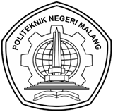
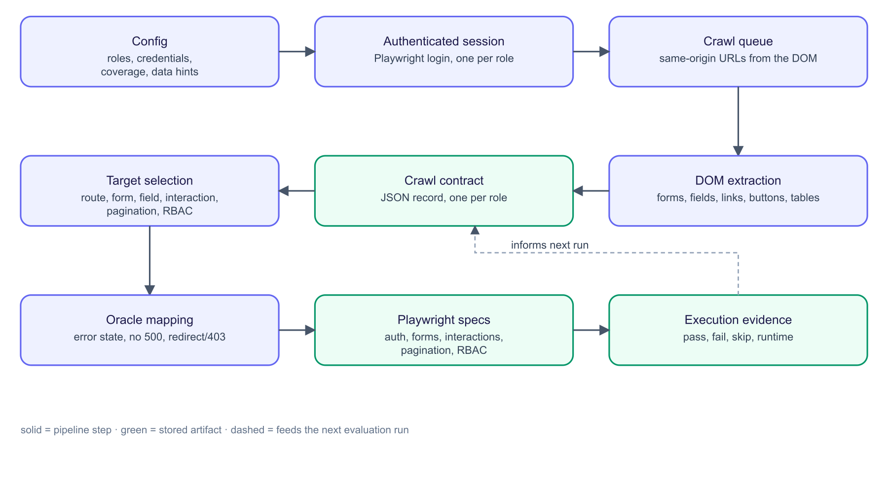
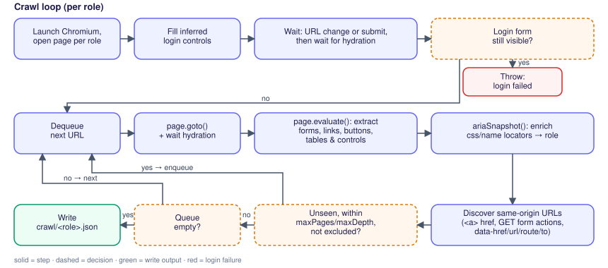
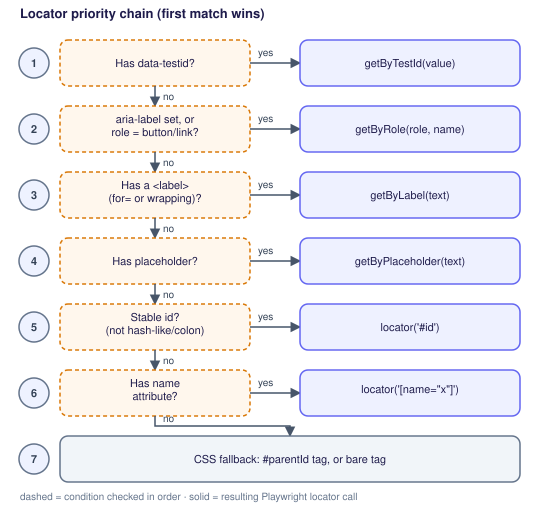
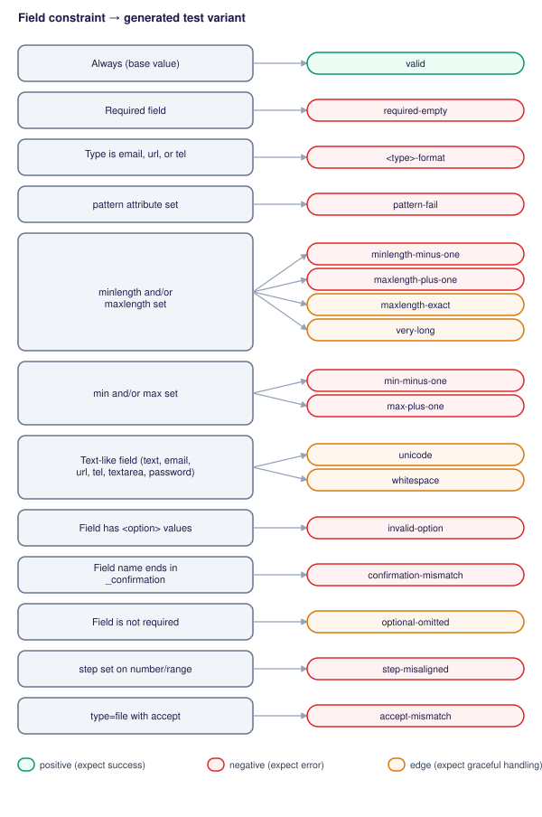

<!-- _class: cover -->
<!-- _paginate: false -->

Penelitian Reguler Kompetisi

Desain dan Implementasi TathyaTest: Test Case Generator Otomatis untuk Pengujian Fungsional Aplikasi Web

<strong>TIM PENELITI</strong> 
Ketua: Dian Hanifudin Subhi, S.Kom., M.Kom. 
Anggota: 
1. Dika Rizky Yunianto, S.Kom., M.Kom. 
2. Ridwan Rismanto, S.ST., M.Kom., Ph.D. 
3. Usman Nurhasan, S.Kom., M.Kom. 
<em>Dana DIPA Polinema, SP DIPA-139.03.2.693474/2026</em>

---

<!-- _class: dense -->

# Rumusan Masalah & Tujuan

**Masalahnya**
- Aplikasi kampus (mis. Kompen, Jayanti, Whistleblower) dipakai setiap hari oleh mahasiswa, dosen, dan staf.
- Server yang "hidup" ibarat toko yang pintunya terbuka: belum tentu kasir, stok, dan penjaganya bekerja benar.
- Menguji semua fungsi secara manual lambat. Alat uji otomatis pun masih butuh **skenario uji** yang ditulis manusia.

**Rumusan masalah**
1. Seberapa lengkap pengujian yang dihasilkan TathyaTest?
2. Mampukah menemukan kesalahan yang sengaja disisipkan?
3. Seberapa andal dan hemat waktu dibanding menulis manual?

**Tujuan:** mengukur kelengkapan (target ≥ 80%), kemampuan menemukan kesalahan (target ≥ 85%), serta keandalan dan efisiensinya.

<b>Istilah:</b> <b>skenario uji</b> = satu butir daftar periksa, mis. "login dengan password salah, sistem harus menolak" · <b>RBAC</b> = hak akses berbeda tiap peran (admin, pengguna) · <b>CRUD</b> = tambah, lihat, ubah, hapus data

<!--
Mulai dari masalah sehari-hari: aplikasi kampus dipakai terus, tetapi "server menyala" tidak sama dengan "aplikasi berfungsi benar". Pengujian manual butuh waktu, dan alat otomatis pun masih membutuhkan manusia menulis skenario ujinya. Tiga pertanyaan penelitian: seberapa lengkap, mampukah menemukan kesalahan, dan seberapa hemat waktu.
-->

---

<!-- _class: dense -->

# Metode Penelitian

<b>1. Masuk</b> robot login sebagai tiap peran pengguna

<b>2. Menjelajah</b> membuka semua halaman (<i>crawling</i>), mencatat tombol, formulir, dan menu

<b>3. Menyusun</b> skenario uji dibuat otomatis dari catatan itu

<b>4. Menjalankan</b> diuji di tiga browser (Chrome, Firefox, WebKit)

**Dibangun bertahap (*Prototyping*)** dan dievaluasi pada **dua aplikasi studi kasus internal** (Laravel Blade dan Laravel Inertia-React) serta **SauceDemo**, toko online contoh sebagai pembanding.

<b>Istilah:</b> <b>DOM</b> = struktur halaman yang tampil di browser · <b>crawling</b> = menelusuri halaman satu per satu seperti pengunjung

<!--
Cara kerja TathyaTest dalam empat langkah: robot masuk sebagai tiap jenis pengguna, menjelajahi halaman dan mencatat apa yang ada, menyusun skenario uji dari catatan itu, lalu menjalankannya di tiga browser. Alat dikembangkan bertahap lewat prototipe. Evaluasi hanya memakai dua aplikasi studi kasus internal dan SauceDemo; aplikasi Kompen, Jayanti, dan Whistleblower belum diuji dan menjadi tahap lanjutan.
-->

---

<!-- _class: dense -->

# Cara Menjelajah Halaman

<b>1. Masuk</b> robot login satu kali untuk tiap peran

<b>2. Buka &amp; catat</b> tiap halaman dibuka, tombol, formulir, dan tabelnya dicatat

<b>3. Cari lagi</b> alamat halaman baru dari tautan dan formulir

<b>4. Ulangi</b> sampai tidak ada halaman baru

<b>Istilah:</b> <b>peran</b> = jenis pengguna (admin, pengguna biasa) · <b>hidrasi</b> = halaman selesai dimuat penuh oleh JavaScript

<!--
Alur rinci robot penjelajah. Untuk tiap peran robot login satu kali, lalu mengulang: ambil alamat dari antrean, buka halaman, catat formulir, tautan, tombol, dan tabel, lalu cari alamat baru sampai antrean habis. Jika login gagal, proses berhenti dengan pesan jelas.
-->

---

<!-- _class: dense -->

# Cara Menyusun Skenario Uji

**Memilih cara menemukan tombol**

**Aturan isian menjadi skenario uji**

<b>Istilah:</b> <b>locator</b> = cara robot menemukan satu elemen di halaman (urut dari yang paling stabil ke cadangan) · <b>batasan isian</b> = aturan formulir, mis. wajib diisi, panjang maksimum

<!--
Kiri: robot memilih cara menemukan elemen dari yang paling stabil (id pengujian, peran, label) hingga cadangan CSS; posisi urutan sengaja dihindari. Kanan: tiap aturan isian formulir (wajib, format, pola, panjang, rentang, pilihan) otomatis menjadi skenario benar, salah, atau batas.
-->

---

<!-- _class: dense -->

# Hasil Penelitian

**Seberapa lengkap?**
Skenario uji dibuat otomatis: **104** (Blade), **106** (Inertia-React), **31** (SauceDemo). Elemen halaman dikenali **95,5%** dan **100,0%**. Hasil sama di tiga browser (κ = **1,00**). Kode aplikasi yang dijalankan: **36,1%** (UI-level).

**Bisakah menemukan kesalahan?**
**14 kesalahan** sengaja disisipkan oleh tim (mis. tombol hapus dibuat tidak menghapus), lalu dihitung berapa yang tertangkap (target 85% terpenuhi; tulisan manual hanya **21,4%**):

Blade<i style="width:100%"></i><b>100,0%</b>

Inertia-React<i style="width:85.7%"></i><b>85,7%</b>

**Seberapa cepat?**
Perkiraan **30,0–32,7 kali lebih cepat** daripada menulis skenario uji secara manual, (*perkiraan*: 5 menit per skenario; jika ±50%, 15–49 kali).

**Ada temuan nyata?**
Ya, **dua kesalahan nyata** pada aplikasi uji: tombol "halaman berikutnya" salah terbaca, dan satu alamat halaman menampilkan error server (500).

<!--
Empat pertanyaan, empat jawaban. Lengkap: ratusan skenario uji dibuat otomatis dan hampir seluruh elemen halaman dikenali. Kemampuan menemukan kesalahan diukur dengan menyisipkan 14 kesalahan yang dibuat tim: TathyaTest menangkap semuanya di aplikasi Blade dan 85,7% di Inertia-React; dua yang lolos dijelaskan di laporan. Kecepatan adalah perkiraan, dihitung dari asumsi 5 menit untuk menulis satu skenario uji secara manual. Dua kesalahan nyata juga ditemukan.
-->

---

<!-- _class: dense -->

# Simpulan & Keterbatasan

**Simpulan**
1. Cakupan model elemen **95,5%** (Blade) dan **100,0%** (Inertia-React), melampaui target 80%.
2. Akurasi deteksi cacat **100,0%** dan **85,7%**, memenuhi target 85%; semua cacat pengecoh selamat.
3. Dua cacat nyata ditemukan pada aplikasi uji.
4. Andal lintas browser (κ = 1,00), perkiraan **30,0–32,7×** lebih cepat.

**Keterbatasan**
- Pemeriksa hasil hanya melihat tampilan halaman: tombol *logout* berbasis skrip di Inertia-React tidak terjangkau, sehingga 2 cacat luput (rute 7/8).
- Kode aplikasi yang dijalankan baru 36,1%.
- Daftar kesalahan disusun tim sendiri.
- Aplikasi internal jurusan belum diuji.

<b>Istilah:</b> <b>cacat pengecoh</b> = perubahan yang sengaja tidak boleh terdeteksi, untuk memastikan alat tidak asal menandai kesalahan

<!--
Simpulan mengikuti BAB V laporan: cakupan melampaui target 80%, akurasi deteksi cacat memenuhi target 85%, dua cacat nyata ditemukan, dan keandalan serta efisiensi baik. Keterbatasan: pemeriksa hasil berbasis tampilan halaman tidak melihat kontrol berbasis skrip, sehingga logout di Inertia-React tidak terjangkau dan dua cacat luput; cakupan kode 36,1%; daftar kesalahan buatan tim; aplikasi internal jurusan belum diuji.
-->

---

<!-- _class: dense -->

# Luaran

**Luaran wajib**
1. **IPTEKSB berupa prototipe** TathyaTest (**TKT 4**): selesai dibangun dan dievaluasi pada 3 aplikasi studi kasus
2. **Artikel jurnal ilmiah (JUTI)**: telah disubmit 13 Oktober 2026

**Luaran tambahan**

3. **Kekayaan Intelektual (KI) berupa Hak Cipta** prototipe TathyaTest: dalam proses pendaftaran

**Langkah berikutnya:** menerapkan TathyaTest pada aplikasi internal jurusan (Kompen, Jayanti, Whistleblower).

<b>Istilah:</b> <b>TKT</b> = Tingkat Kesiapterapan Teknologi, skala 1–9; <b>TKT 4</b> = komponen teknologi sudah teruji di laboratorium

<!--
Luaran wajib: prototipe pada tingkat kesiapan teknologi 4 (teruji di laboratorium) yang sudah dievaluasi pada tiga aplikasi studi kasus, dan artikel untuk jurnal JUTI yang telah disubmit. Luaran tambahan: Kekayaan Intelektual berupa Hak Cipta yang sedang didaftarkan. Langkah berikutnya adalah mencoba pada aplikasi internal jurusan.
-->

---

<!-- _class: thanks -->

# Terima Kasih

TERIMA KASIH

 

github.com/dhanifudin/tathyatest
